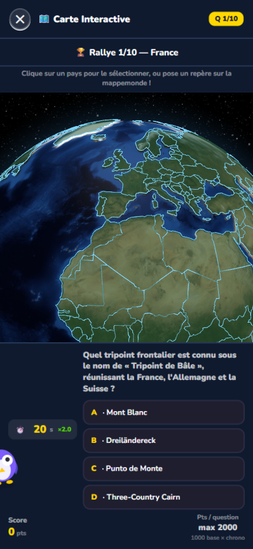
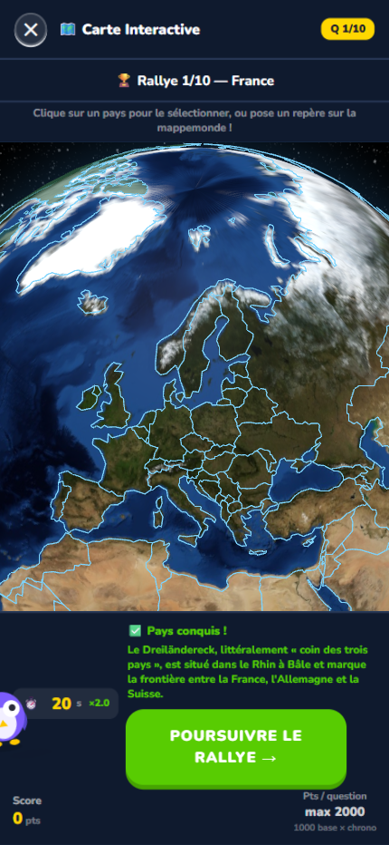
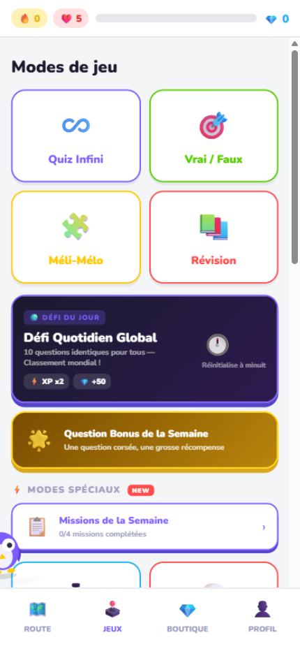

<div align="center">

# 🦉 KnowQuest

### La culture générale, façon jeu vidéo

*[](data/questions/index.json)
[](#-contenu)
[](#-modes-de-jeu)
[](#-installer-lapplication)*

XP, niveaux, gemmes, **Trophy Road**, boss légendaire, globe 3D et carrière F1 :
un quiz qui se joue comme un RPG — 100 % navigateur, installable sur mobile.

**[🎮 Jouer maintenant](#-lancer-le-jeu)** · [Modes de jeu](#-modes-de-jeu) · [Screenshots](#-aperçu-du-jeu)


> 🎥 [Voir la démo vidéo (MP4, 39 s, avec musique)](docs/media/knowquest-demo.mp4) —
> Trophy Road, globe 3D, carrière F1, profil, compteurs et la mascotte chouette en transition

</div>

---

## ✨ Ce qui rend KnowQuest unique

| | |
|---|---|
| 🗺️ **Trophy Road** | Un parcours de 40 paliers en 8 chapitres, avec paliers bronze → platine, boss de fin de chapitre et récompenses (gemmes, cœurs, items) |
| 🌍 **Globe 3D** | Rallye du Monde & Carte Interactive : conquiers des pays en plaçant tes réponses sur un globe terrestre en 3D |
| 🏎️ **Carrière F1** | Grand Prix & Championnat : qualification → course → podium, coéquipier rival, R&D de l'écurie entre les courses |
| 🃏 **Collection** | Chaque bonne réponse peut débloquer une **fiche** à collectionner (atlas, raretés, vitrine) |
| 👾 **Boss & événements** | Boss légendaire mensuel multi-phases, événements saisonniers réels (rentrée, fêtes…) avec XP doublé |
| 🧠 **Révision intelligente** | SRS : le jeu sait ce que tu as oublié et te le repropose au bon moment |
| 🔥 **Streaks & missions** | Missions quotidiennes et hebdo, défis globaux classés, séries à ne pas briser |

## 🎮 Modes de jeu

<details open>
<summary><b>Cliquer pour déplier la liste complète</b></summary>

| Mode | Principe |
|---|---|
| ♾️ Quiz Infini | Des questions à la chaîne, classées par ELO |
| 🎯 Vrai / Faux | Réflexes : 304 affirmations à trier |
| 🧩 Méli-Mélo | Remets les événements dans l'ordre |
| 📚 Révision | Cartes SRS de ce que tu commences à oublier |
| 🌍 Défi Quotidien Global | 10 questions identiques pour tous les joueurs, classement mondial |
| ⏱️ Quiz Chrono | Chaque seconde compte |
| 💀 Mode Survie | 3 vies, pas d'erreur pardonnable |
| 🤖 Duel IA | Bats le robot |
| ⚡ Question Flash | 5 secondes chrono |
| 🕰️ Frise du Temps | Classe l'Histoire |
| 🏆 Rallye du Monde | 10 pays à conquérir sur le globe |
| 🌍 Tour du Monde | 30 étapes narrées, +300 XP à la clé |
| 🗺️ Carte Interactive | Place les pays sur la mappemonde |
| ⛓️ Chaîne de Connaissance | Ne brise pas la chaîne |
| 🏎️ Grand Prix | Qualification → Course → Podium |
| 🏆 Championnat du Monde | 5 Grands Prix, gloire éternelle |

</details>

## 📸 Aperçu du jeu

| Globe 3D — Rallye du Monde | Pays conquis ! |
|:---:|:---:|
|  |  |

| Modes de jeu | Collection de fiches |
|:---:|:---:|
|  |  |

## 🚀 Lancer le jeu

Le jeu charge ses données via `fetch()` : un petit serveur local suffit.

```bash
# à la racine du projet
python -m http.server 8080
```

puis ouvrir **http://localhost:8080/web/index.html** 🎉

> 💡 Aucune dépendance, aucun build : du HTML, du JS et du JSON.

## 📱 Installer l'application

KnowQuest est une **PWA** : sur mobile, ouvre le jeu puis appuie sur
**📲 Installer** (ou « Ajouter à l'écran d'accueil »). Le jeu fonctionne
ensuite **hors ligne** grâce au service worker et au cache des données.

## 🗂️ Contenu

```
web/      ← le jeu (index.html, modules js/, service worker, manifest PWA)
data/     ← roadmap.json (Trophy Road) + banques de questions
```

**3000 questions QCM** réparties en 12 catégories, plus 304 Vrai/Faux
et 150 Méli-Mélo :

`🌍 Géo (700)` · `⚽ Sport (711)` · `🍽️ Gastra (438)` · `📜 Hist (296)` ·
`🧪 Sci (156)` · `🏰 Châteaux (127)` · `🎨 Art (109)` · `⚡ Mytho (99)` ·
`🎬 Cinéma (98)` · `🌟 Extended (95)` · `📖 Litt (85)` · `🎲 Mixed (86)`

Les questions sont éclatées par catégorie dans [`data/questions/`](data/questions/index.json)
(chargement en parallèle + cache hors-ligne), avec repli automatique sur
[`questions.json`](data/questions.json).

---

<div align="center">

Fait avec ❤️, beaucoup de ☕ et un pipeline de génération par IA

**🦉 KnowQuest — parce que la culture, ça se gagne.**

</div>
